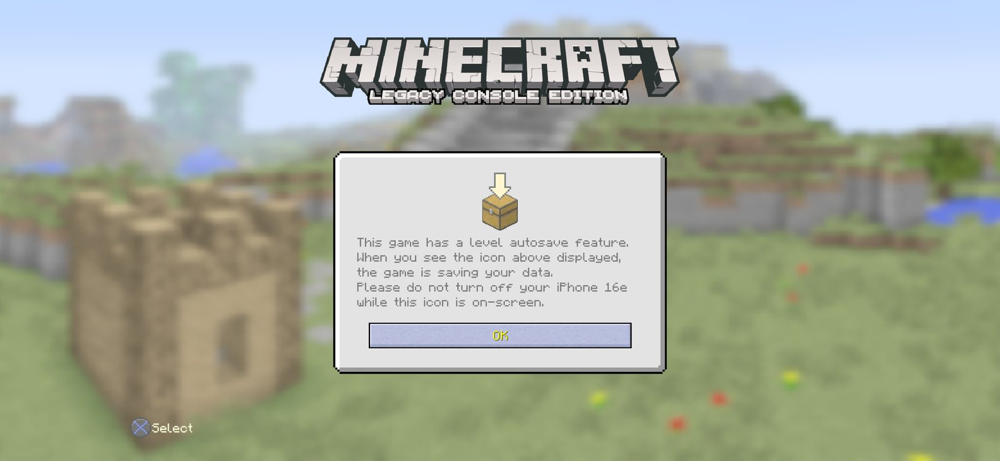
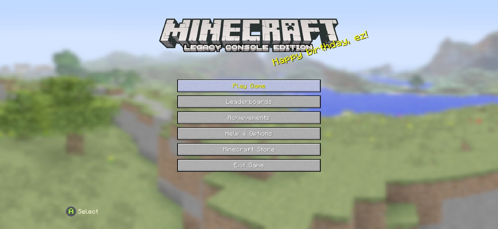
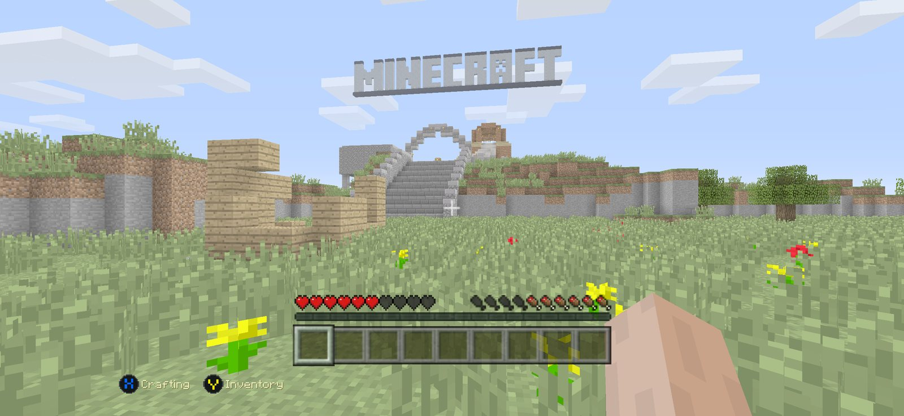
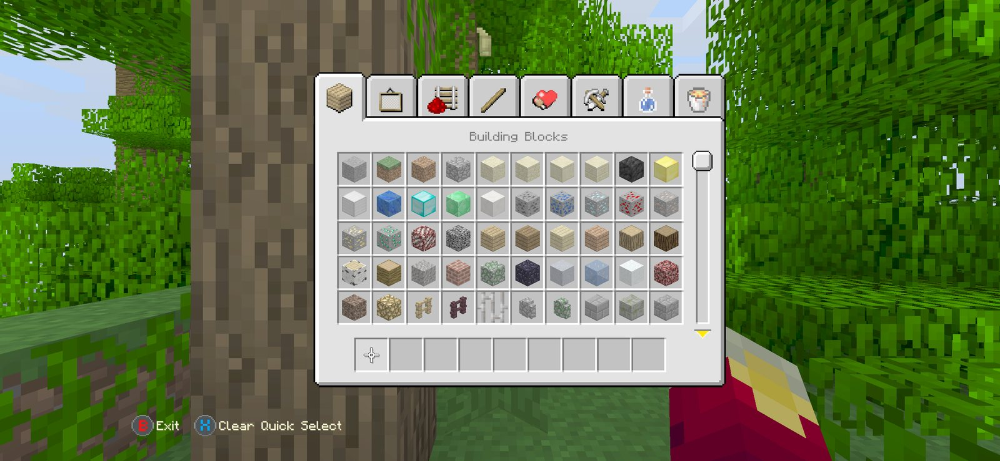

# MCLCE-iOS

Native iOS port of TU19 Legacy Console Edition. **There are no Minecraft game files in this repo, you must provide them.**

**It's playable!** All aspects of the game except multiplayer are working, including the full menu tree, HUD, inventory/crafting screens, survival/creative modes, the tutorial, the Nether and the End, saving and use of texture/skin packs. See [STATUS.md](STATUS.md) for more details and known issues.

There may be small issues or bugs here and there, if you find any, be sure to open an issue in the Issues section.

The most recent build is available on [Releases](https://github.com/dtentiion/MCLCE-iOS/releases/latest), and will be updated on each commit to `main`.

  
  
  
  

## Further options

This builds the TU19 Legacy Console Edition base. If you're after a different version, there are other repos which build similar content:

- **MCLCE-iOS** (this one): TU19 base, the 'canonical' LCE code base.
- **NeoLegacy-iOS** (planned): a community maintained version of NeoLegacy, once a branch has been created.
- And other options, maybe.

Select the appropriate repo, and download the resulting `.ipa` from its Releases page, and install via AltStore, Sideloadly, xtool or TrollStore.

## What it is

An (almost) direct port of the LCE code, with no emulation, Wine or other tricks. Just an ordinary `.ipa`.

## How to play

Using a suitable MFi controller (Xbox or PlayStation, and any others should do) only. There are no input facilities for using the touchscreen.

## Requirements

- An iPhone (should work on an iPad, but this hasn't been tested)
- iOS 14 or later
- A controller

## How it's built

It's written in C++ using CMake, like the original.

Since I don't have any other OSes to test on, the iOS build is done using GitHub Actions' available macOS runners, and the resulting .ipa is released via Releases. Further details in [.github/workflows/ios.yml](.github/workflows/ios.yml)

### Building on your own

You'll need access to a Mac with Xcode 16 to build this. If you have a Windows machine you can still contribute by forking the repo, pushing a branch and retrieving the resulting build from Actions.

### Components

- the TU19 source, adapted to run on iOS, plus some additional shims to deal with the Windows and console versions
- a Metal implementation of 4J's rendering API, which also handles the game's existing GL calls
- the game's Flash (`.swf`) menus and other on-screen information, presented using a modified version of [Ruffle](https://ruffle.rs/), in `third_party/ruffle_ios/` and available at [dtentiion/ruffle](https://github.com/dtentiion/ruffle) (on the `mclce-ios-patches` branch)
- audio via [miniaudio](https://miniaud.io), identical to what's used by the console version in `SoundEngine.cpp`, playing the included `.ogg` sound files
- controller support via Apple's GameController framework, providing inputs consistent with the 4J input API expected by the game

## Installing

Further details in [INSTALL.md](INSTALL.md)

## Roadmap

See [ROADMAP.md](ROADMAP.md) and [STATUS.md](STATUS.md)

## Contributing

Help is always appreciated, especially where your knowledge of iOS and/or Metal would be useful, or the inner-workings of the Flash UI used by the game. Please open an issue to discuss proposed work to avoid overlap.

### General guidelines

- strive to make changes equivalent to those in the TU19 Legacy Console Edition source
- make small, discrete changes
- don't include any game-related material in the repository

## Legal

This is an unofficial port of TU19 Legacy Console Edition to native iOS. Minecraft is a trademark of Mojang AB / Microsoft. This project is not affiliated in any way at all, endorsed by, or connected to Mojang, Microsoft, or 4J Studios. **You have to provide your own game files, there are no game files supplied in this repository.**
